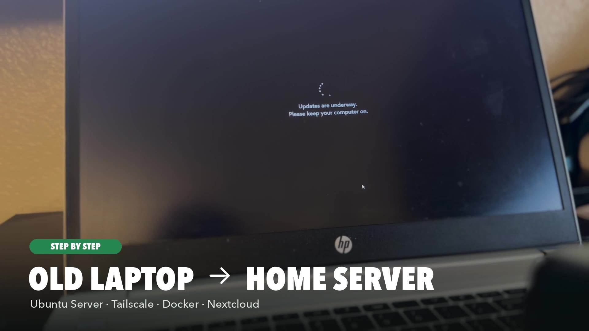

# How to Turn Your Home Laptop into a Home Server (2026)

Every command and file from the video, ready to copy. You start with an old Windows laptop and end with a home server that stores your files, which your phone can open straight from the laptop over your home Wi-Fi, even with the internet down.

[](https://youtu.be/gMrg4DRL0K4)

> 🎬 **Watch the video:** [How to Turn Your Home Laptop into a Home Server (2026)](https://youtu.be/gMrg4DRL0K4)
>
> 📝 **The full write-up:** [emmanuelnyatefe.com/blog/turn-your-laptop-into-a-home-server](https://emmanuelnyatefe.com/blog/turn-your-laptop-into-a-home-server)

---

## What you need

- **An old laptop.** The video uses an HP ProBook 450 G7: Core i7, 16 GB of memory, a 512 GB drive. Any 64-bit laptop with 4 GB of memory or more will do. **Everything on it gets erased.**
- **A USB stick** of 8 GB or more, or a microSD card in a USB card reader. Some laptops ignore some sticks; see [step 1](docs/01-download-and-write.md#if-the-laptop-wont-see-the-stick-later).
- **Your everyday computer**, to write the stick and to control the server.
- **Your Wi-Fi name and password.**
- **A phone**, to open your files.

Everything used here is free.

## The steps

| # | Step | What happens |
|---|---|---|
| 1 | [Download and write the stick](docs/01-download-and-write.md) | Ubuntu Server 26.04.1 LTS onto a USB stick with Raspberry Pi Imager |
| 2 | [Boot and install](docs/02-boot-and-install.md) | Start from the stick (HP: Esc, then F9) and install Ubuntu Server over Windows |
| 3 | [Wi-Fi](docs/03-wifi.md) | Connect the laptop to your Wi-Fi with netplan |
| 4 | [SSH](docs/04-ssh.md) | Control it from your own computer |
| 5 | [Tailscale](docs/05-tailscale.md) | Reach it from anywhere, without opening your router |
| 6 | [Docker](docs/06-docker.md) | The engine that runs the apps |
| 7 | [Nextcloud](docs/07-nextcloud.md) | Your own Google Drive, on port 8080 |
| 8 | [Your phone](docs/08-phone.md) | Open your files at home (no internet needed) and away (Tailscale) |
| 9 | [Extras](docs/09-extras.md) | Battery care, closing the lid, updates, backups |

---

## All the commands

The short version, in order. Each step's page explains what the commands do and what to do if one fails. In the commands:
- `192.168.x.x` stands for **your laptop's address**;
- `your-username` stands for **the username you made during the install**.

**On the laptop, after the install (step 3):**

```bash
hostname -I                                   # prints nothing until it's connected
ls /sys/class/net                             # the name starting with "wl" is the Wi-Fi card
dpkg -s wpasupplicant | grep -i status        # should say: install ok installed
sudo nano /etc/netplan/60-wifi.yaml           # paste netplan/60-wifi.yaml, fill in your details
sudo chmod 600 /etc/netplan/60-wifi.yaml
sudo netplan apply
hostname -I                                   # now prints the laptop's address
```

**From your computer (step 4):**

```bash
ssh your-username@192.168.x.x
```

**Tailscale (step 5):**

```bash
curl -fsSL https://tailscale.com/install.sh | sh
sudo tailscale up --hostname=homeserver       # open the link it prints and sign in
tailscale ip -4
```

**Docker (step 6):**

```bash
sudo apt update
sudo apt install -y docker.io docker-compose-v2
sudo usermod -aG docker $USER
exit                                          # then connect again with ssh
docker run --rm hello-world                   # prints: Hello from Docker!
```

**Nextcloud (step 7):**

```bash
mkdir -p ~/nextcloud && cd ~/nextcloud
curl -fsSLO https://raw.githubusercontent.com/KooEmmanuel/laptop-home-server/main/nextcloud/compose.yaml
curl -fsSLO https://raw.githubusercontent.com/KooEmmanuel/laptop-home-server/main/nextcloud/make-env.sh
bash make-env.sh                              # random database passwords + trusted addresses, into .env
docker compose up -d
docker compose ps                             # four containers running, Nextcloud on port 8080
```

**Then open it (step 8):**
- **At home:** `http://192.168.x.x:8080`
- **Anywhere, with Tailscale on:** `http://homeserver:8080`

---

## Files in this repo

| File | What it is |
|---|---|
| [netplan/60-wifi.yaml](netplan/60-wifi.yaml) | The Wi-Fi settings file, with placeholders for your network |
| [nextcloud/compose.yaml](nextcloud/compose.yaml) | The four Nextcloud containers |
| [nextcloud/make-env.sh](nextcloud/make-env.sh) | Makes the `.env` file: random database passwords and the addresses Nextcloud answers on |

## Keep it private

- **Nothing here opens your server to the internet.**
  - Port 8080 is only reachable on your home network.
  - Away from home, you get in through Tailscale.
  - Don't port-forward 8080 on your router.
- **Never post or commit** your filled-in Wi-Fi file or your `.env`. They hold your passwords.
- **If you film your own setup,** blur your IP addresses, username, Wi-Fi name and Tailscale login link.

## License

[MIT](LICENSE). Use it, change it, share it.
